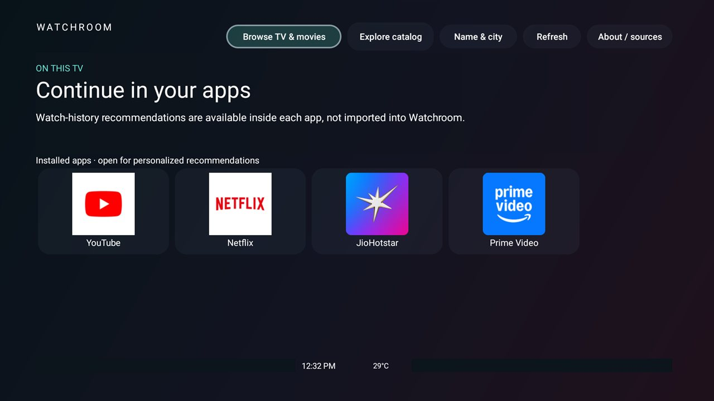

# Watchroom

One optional companion screen with installed-app logos and names, and separately labeled
public-catalog exploration with a title/synopsis hero, poster shelves and stacked-card picker.
There is no subscription panel.
The personalized greeting, clock and city weather stay in a small footer.
TV/movie search and optional manual renewal-date management remain available through Browse.
No games or assistant. It never changes
or becomes the actual launcher.
Keep its module card hidden and remove its ordinary Home shortcut if you prefer to open it only
from App library. No trailers, account access or new launcher dependencies.

## Controls

- **Dashboard:** opens with shortcuts to supported installed apps (YouTube, Netflix,
  JioHotstar and Prime Video), using their installed logo resources beside their names.
  Open an app to use its own personalized recommendations. Watchroom does not have access to
  those apps' private watch histories. The shared Android TV preview, Watch Next and channel
  tables returned no entries on the tested TV; this is not an imported recommendation feed.
  No catalog request or poster download runs on this default screen.
  The header/footer sit inside a 5% overscan-safe inset on each edge. Buttons use explicit
  padding/minimum sizes, and the weather footer can wrap instead of clipping.
- **Explore catalog:** explicitly loads the public sample search; it is not labeled Top picks.
  Focus a poster to update the title, synopsis, year, genre and
  original network/platform in the hero. A second shelf shows other results sharing the first
  listed genre; it is not a personalized recommendation engine.
  **Name & city** stores an optional name, city label and city-level latitude/longitude on this
  TV. Coordinates, not the name or city label, are sent to Open-Meteo. No GPS is used.
  The screen shows up to eight TVmaze results for "Dark", not trending or personalized picks.
  OK shows source details and the availability caveat. Thumbnail downloads
  are bounded to eight provider-hosted medium portraits, at most 300 KB each, decoded at a
  bounded size; the hero and stacked cards reuse those same bitmaps.
  **Pick one** opens a separate full-size stacked-card view: **Pass** advances,
  **Source details** opens details, and **Like** saves the source link locally and advances.
  Likes are stored only on this TV (up to 128); they do not change recommendations or send feedback.
  Left/Right on the focused poster cycles cards; Back returns to catalog exploration.
  Back again returns to the installed-app screen.
  There is no blur, video, animated swiping or background discovery.
  Installed-app logos also appear in the catalog footer. Uninstalled or unlaunchable apps
  are omitted; a failed launch produces an explicit message. Nothing is installed automatically.
- **Browse TV & movies** opens the search/catalog screen below. Back returns to the dashboard;
  Home still opens your existing launcher. **Refresh** refreshes weather and, only in
  catalog exploration, the sample results.
- **TV shows / Movies:** search a title, person or keyword; **Refresh** retries the current query.
  The initial searches are "Planet" and "Bollywood", not trending or personalized recommendations.
- **Browse > Pick one:** choose from the loaded search results. Left/Right browse, OK opens details;
  Previous/Next and Random pick do the same with buttons. Back returns to the search results.
- **Browse > Subscriptions:** enter a service name, renewal date (`YYYY-MM-DD`) and One time, Monthly or Yearly.
  OK on an entry offers Edit and Delete. Dates are stored only on this TV. Recurring dates are
  calculated from the original date: January 31 becomes February 28/29, then March 31.
  One-time past dates remain marked as past. These are user-entered dates, not verified payments
  or expiry dates. There are no background reminders. At most 20 entries are stored.
- **About:** source attribution, data license, privacy and limitations.

## Data and limitations

- TV shows use the [TVmaze public API](https://www.tvmaze.com/api), without an API credential.
  Provider ratings are not displayed. **IMDb ratings are unavailable until a verified
  IMDb-compatible data source is connected**; scores are never relabeled or invented.
  The original network/web channel
  is **not** a check of current availability in India, nor a link to play the show.
  TVmaze metadata is licensed [CC BY-SA 4.0](https://creativecommons.org/licenses/by-sa/4.0/);
  the app attributes the source and provides each show's TVmaze link. No catalog is bundled.
  Dashboard thumbnails are fetched from the provider's documented image CDN while foregrounded;
  none are bundled in the APK.
- Dashboard weather uses [Open-Meteo](https://open-meteo.com/), credited in About, under
  [CC BY 4.0](https://creativecommons.org/licenses/by/4.0/). Location is entered as city-level
  coordinates, not obtained from device location services.
- Movies use the [Apple Search API](https://performance-partners.apple.com/search-api), India
  catalog, without an API credential. The app filters the general results to feature movies;
  Apple's movie-specific filters returned empty results during testing. Only factual metadata
  and source-listing links are displayed; no promotional artwork, previews or descriptions.
  Results are not exhaustive. **Audience ratings and cross-provider streaming availability are
  not supplied.** Age classifications are labeled separately and are never presented as ratings.
- The app cannot say whether Netflix, Prime Video or JioHotstar currently includes a title in
  your subscription. Comprehensive region-specific availability would need another provider.
- A listing opens through Android's normal link handler, if available. Otherwise its address is
  shown explicitly; no browser or streaming app is installed automatically.
- Installed streaming apps do not expose a standard billing-data interface. Watchroom does not
  scrape private files, obtain tokens or read accounts. Dates must be entered or independently
  verified through an ordinary account screen. Protected/black screens are not bypassed.
  App presence, a profile or a working shortcut is never treated as evidence of a paid plan.

## Permissions

- `INTERNET`: HTTPS searches to `api.tvmaze.com` and `itunes.apple.com`, TV thumbnails from
  `static.tvmaze.com`, and weather from `api.open-meteo.com`, only while the relevant screen is on
  screen. Search terms and the connection's public address reach the selected provider.
  City-level coordinates necessarily reach Open-Meteo. Profile names, city labels and subscription
  names/dates are never sent. Source links open only on an explicit press.
- No location, accessibility, storage, account or notification permissions. No ads, telemetry,
  services, alarms, scheduled polling or boot receivers. Leaving cancels in-flight requests;
  a canceled search is retried when you return. Loaded results otherwise remain in memory.
  The dashboard refreshes on return after 15 minutes or on Refresh, not on a scheduled timer.
  Its visible clock updates once per minute and stops updating when hidden. The manifest's four
  package queries only discover the four shortcut apps; there is no all-packages permission.
- Local preferences are not included in Android backup. No billing credentials are requested.

## Build and checks

JDK 17 and Android SDK 34, as for the other add-ons:

```sh
./gradlew --no-daemon testReleaseUnitTest lintRelease assembleRelease
```

On Windows use `.\gradlew.bat` with the same arguments. Release sideload builds use the local
debug signing key, following the other small add-ons; use your own private signing key for releases.
No APK belongs in the repository.

Unit tests cover source parsing and missing/error metadata, safe listing and thumbnail URLs,
query/coordinate bounds, current-weather parsing, manual date serialization, recurring
end-of-month/leap-year behavior and invalid saved data.
Validate on a real TV with D-pad navigation, Home/Back, subscription add/edit/delete and persistence.
No performance benchmark is part of this add-on's validation.

Tested on **SCBC R4, Android 11**: live TVmaze results and India movie results, D-pad tab navigation,
Left/Right picking, invalid subscription input, add/edit/delete and persistence after a process
restart. Blank searches are rejected visibly, genuine empty results are shown without demo data,
and editing the query loads live results again. The app is reachable from App library while its
Home shortcut stays hidden. Test subscriptions were deleted afterwards; enter your own renewal dates.
The dashboard was also verified for live city weather, personalized greeting, bounded thumbnails,
D-pad access to picking, an installed-app shortcut, Back/Home navigation and
personalization persistence after a process restart. The screenshot redacts the owner's name and city.
The cinematic layout was checked on the same TV for focus-driven hero updates, source dialogs,
Pass/Like advancement, returning from the card picker, and unchanged Home behavior.
The installed-app layout was verified for all four app logos/names, D-pad navigation and
YouTube launch. Every dashboard text/control bound was checked inside the 5% safe area at
1920x1080, including catalog exploration and the picker. TVmaze scores are absent from
Browse, source dialogs and the dashboard; no IMDb score is claimed. This does not verify
watch-history imports or IMDb integration, which remain unavailable.


